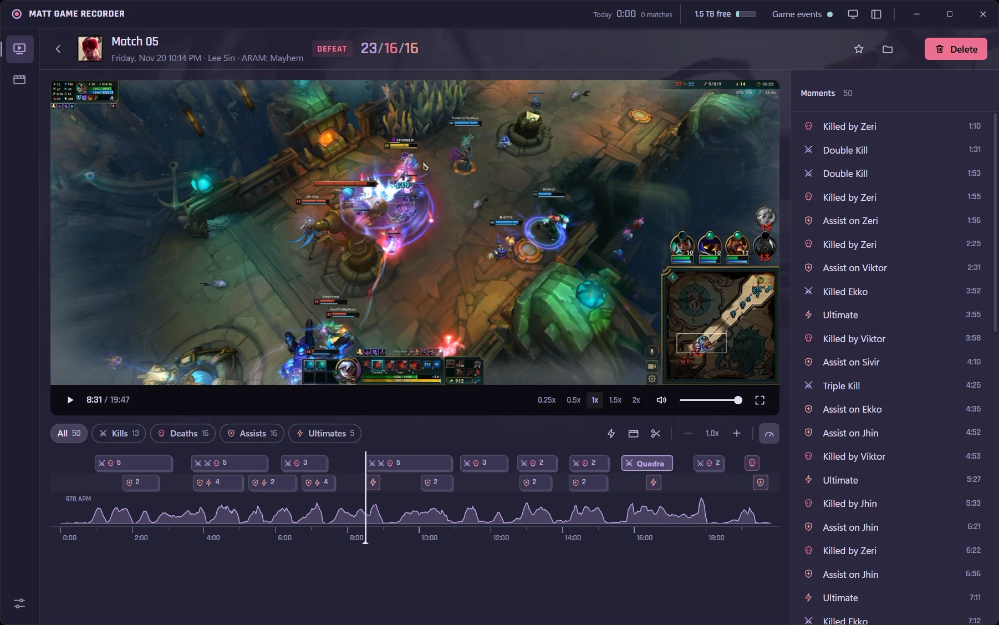
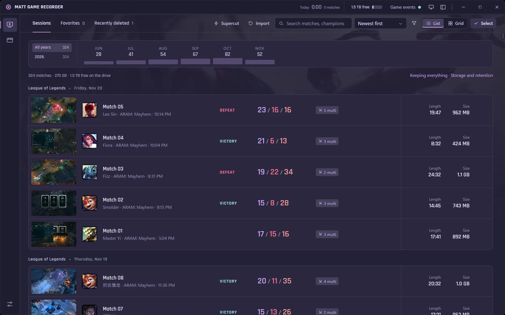
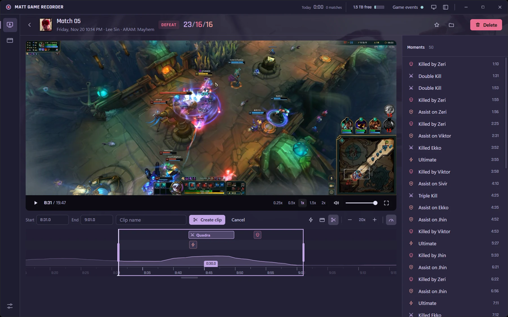
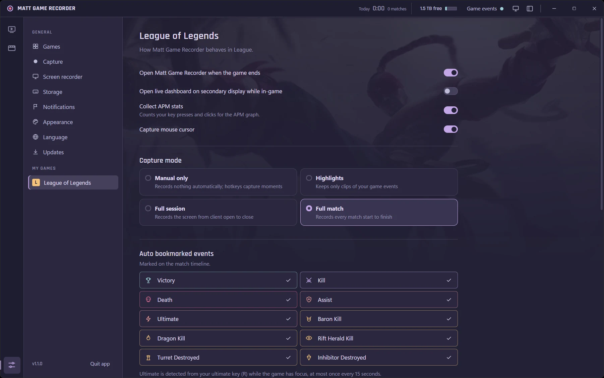

# Matt Game Recorder

**A local, ad-free League of Legends recorder for Windows and macOS.** It records every match on
its own, marks every kill, death and objective on the timeline, and gets you from "GG" to the
play you want to see in two clicks. No account, no cloud, no ads.

[**Download the latest release**](https://github.com/mattcui951/matt-game-recorder/releases/latest)



## Features

### Every moment, already marked

Kills, deaths, assists, multikills, ultimates, dragons, barons, heralds, turrets, inhibitors and
the win itself land on the timeline while you play, read live from Riot's own game data. Click a
moment and the video jumps there. Filter to just your deaths for a quick review, or just your
kills for the fun part. The APM graph underneath shows where your hands were busiest.

### Your match history at a glance

Every game is a row with its champion, result, KDA, multikills, length and size, grouped by day,
with a month-by-month bar to jump through the year. Search by champion, filter by result or event,
keep favorites, and get back anything you deleted by mistake.



### A highlight reel in one click

Instant supercut picks the moments for you: tick quadra kills, triple kills, doubles, deaths or
ultimates, choose how many seconds to keep before and after each one, and it cuts them into one
video. Moments close together are joined, so nothing plays twice.


### Trim the play, share the clip

Quick trim zooms the timeline in on the moment, lets you drag the start and end, and saves it as a
new clip. For more, a small video editor combines clips from several games, slices and
reorders them, and exports in 16:9, 9:16 for phones, 1:1, 4:5 or 21:9.



### Set it once, then forget it

Pick how League is recorded: the full match, only the highlights around your events, the whole
session from client to close, or nothing until you press a hotkey. Choose which events get
bookmarked, and whether the app opens itself when the game ends.



### Light on your PC

- **Frames never leave the GPU.** Capture and encoding run on the graphics card (NVENC AV1 on
  Windows, VideoToolbox on macOS), so recording costs well under 1% CPU.
- **Small files.** AV1 recordings, and a highlights mode that keeps only the seconds around your
  events.
- **Plain files on your disk.** Every recording is an MP4 with a small sidecar file; copying the
  folder is a full backup.
- **Coming from Outplayed?** Import converts your old library, champion, KDA and timeline included.

### Make it yours

28 themes (dark, light and high contrast), each one tweakable, and eight languages: English, 简体中文, 繁體中文, Español,
Français, 日本語, 한국어 and Русский.

<table>
  <tr>
    <td></td>
    <td></td>
  </tr>
</table>

## Install

**Windows:** download `Matt.Game.Recorder_*_x64-setup.exe` from the
[latest release](https://github.com/mattcui951/matt-game-recorder/releases/latest) and run it.
The installer is not code-signed, so Windows may say "Windows protected your PC": click
**More info**, then **Run anyway**. Recordings go to `Videos\Matt Game Recorder` until you pick
another folder in Settings > Storage.

**macOS (13 or later, Apple silicon or Intel):** download `Matt.Game.Recorder_*_universal.dmg`,
open it and drag the app to Applications. Releases are signed with Developer ID and notarized
by Apple. On first start it asks for Screen & System Audio Recording (needed to record);
APM and the ultimate mark also need Input Monitoring, the microphone needs Microphone access.
Settings > Capture shows which permissions are missing and opens the right System Settings page.
Recordings go to `~/Movies/Matt Game Recorder`. With ad-hoc signing, macOS may ask for Screen
Recording again after an update, because the app's signature changes with every build.

## Updates

The app checks the latest GitHub release shortly after it starts and every 6 hours (Settings >
Updates turns this off). A new version shows a banner; nothing installs until you click
**Update now**, and never while League is running or a match is being recorded or saved,
because the installer closes the app. Windows asks for permission (the app installs for all
users), then the new version starts by itself. Recordings, settings and an import in progress
are kept; the import resumes after the restart.

Updates are verified: `latest.json` and the installer's signature are checked against the
public key in `src-tauri/tauri.conf.json` before anything runs.

## How it works

On Windows:

- **Capture**: one `ffmpeg` process grabs the game window with Windows Graphics Capture
  (`gfxcapture`) and encodes it on the GPU (NVENC AV1 by default). Frames never leave the GPU,
  so recording costs well under 1% CPU. The recorder's own windows are never in the video.
- **Audio**: WASAPI loopback of the chosen output device (or only the game process) plus the
  chosen microphone, mixed in Rust and fed to ffmpeg through a named pipe.
- **Files**: ffmpeg writes fragmented MP4 to a pipe. Full match: fragments go to a file that is
  finalized at the end. Highlights/manual: fragments sit in a RAM (or disk) ring buffer and clips
  are cut by copying fragments, no re-encode. Keyframes every 2 s.
- **Events**: Riot's Live Client Data API (`https://127.0.0.1:2999`) is polled once a second.
  Kills, deaths, assists, multikills, enemy turrets/inhibitors, ally dragon/herald/baron and
  victory are mapped to the active player. Ultimate is detected from the ultimate key while
  the game has focus (the API does not report casts). APM comes from low-level input hooks,
  only while a match is recorded and only when the game window is focused.
- **Library**: plain files in the media folder (`Videos\Matt Game Recorder` by default); every
  recording has a `.mgr.json` sidecar with events and APM. Copying the folder is a full backup.

On macOS, events, files and the library work the same; capture, audio and input differ:

- **Capture**: ScreenCaptureKit captures the game window (or a display) and scales it on the GPU.
  NV12 frames go to ffmpeg through a FIFO, clocked by wall time like the audio (the latest frame
  repeats while the screen is still), and VideoToolbox encodes them (HEVC by default). The
  content filter leaves the recorder's own windows out of display recordings
  (`src-tauri/src/capture/sck.rs`).
- **Audio**: the system sound comes from a second ScreenCaptureKit stream (only the game when
  "captures only the game" is on, otherwise every app but this one), the microphone through Core
  Audio (cpal). The same Rust mixer feeds ffmpeg through a FIFO.
- **Input**: a listen-only Quartz event tap (Input Monitoring permission) for APM and the
  ultimate key. League's processes there are `LeagueofLegends` and `LeagueClientUx`.

## Importing

Library > Import offers two imports. Both skip anything already imported, keep running in
the background, pause while a game is being recorded, and resume by themselves after a restart.

- **From Outplayed**: finds Outplayed's media folder from its database, re-encodes every video to
  this app's format on the GPU (AV1 + Opus, about 40% smaller) and keeps champion, KDA, result and
  timeline events, read from Outplayed's IndexedDB (`%LOCALAPPDATA%\Overwolf\CefBrowserCache\Default\IndexedDB\overwolf-extension_cghph..._0.indexeddb.leveldb`).
  Outplayed's own files are never changed; its "Recently Deleted" folder is skipped.
  "Use the CPU as a second encoder" (asks first, off at every launch) converts a second video on
  the CPU with SVT-AV1 alongside the GPU. The speed-up shown is measured on each PC: a 5-second
  test encode per encoder, then updated from real conversions (`encoder-speed.json`, pixels/second).
- **From another Matt Game Recorder folder**: copies sessions and recordings (with their events)
  from another media folder or backup, without converting.

Command line (forwarded to the running app): `matt-game-recorder.exe --import-outplayed <folder>`
or `--import-library <folder>`.

## Develop

```bash
npm install
npm run tauri dev
```

Requires Rust (MSVC), Node 20+, and `ffmpeg.exe` / `ffprobe.exe` (FFmpeg 8.x with `gfxcapture`)
in `src-tauri/binaries/` (`ffplay.exe` too for the mock below). On macOS: the Xcode command line
tools and `ffmpeg` / `ffprobe` in `src-tauri/binaries/` (the static builds release.yml pins).

Platform code sits behind small modules with one file per OS: `platform/` (processes, windows,
displays, disks, fonts, Finder/Explorer), `input/`, `capture/audio/`, plus `capture/sck.rs` and
`capture/fifo.rs` on macOS. To type-check the macOS side on Windows:
`rustup target add aarch64-apple-darwin`, placeholder files `binaries/ffmpeg` and
`binaries/ffprobe` (careful: in Git Bash, `rm binaries/ffmpeg` also matches `ffmpeg.exe`), then
`cargo check --target aarch64-apple-darwin` with `CC_aarch64_apple_darwin` and
`AR_aarch64_apple_darwin` set to stand-in tools that write empty outputs (one build script
compiles C; checking never links).

### Test without playing

```bash
py -I tools/mock_lol.py --length 90
```

Starts a stand-in "League of Legends.exe" window with moving video and a tone, and a fake
Live Client API that plays a scripted match. The running app records it like a real game.

On macOS, put the matching `ffplay` executable next to `ffmpeg` in `src-tauri/binaries/`,
then run `python3 tools/mock_lol.py --length 90`. The stand-in process is named
`LeagueofLegends`; OpenSSL is found on PATH. Allow the recorder's Screen & System Audio
Recording permission in Settings > Capture before starting. Automatic retries check access
silently; the permission button is what opens the system prompt.

Native checks on either platform:

```bash
npm run check
cargo test --manifest-path src-tauri/Cargo.toml --lib
cargo clippy --manifest-path src-tauri/Cargo.toml --all-targets -- -D warnings
cargo run --manifest-path src-tauri/Cargo.toml --example capture_test -- /tmp/mgr-capture 15
cargo run --manifest-path src-tauri/Cargo.toml --example editing_test -- recording.mp4 /tmp/mgr-editing
```

The capture example records the primary display and tests ring-buffer extraction; the editing
example needs a recording longer than 64 seconds. Both choose an available platform encoder.
On macOS, a development build signed ad hoc changes identity on rebuild and may invalidate its
privacy grants. For repeated local testing, set `APPLE_SIGNING_IDENTITY` to an installed
Apple Development or Developer ID Application identity when bundling. Public downloads need
Developer ID Application signing and notarization.

### Preview the UI in a browser

With `npm run tauri dev` running, open
`http://localhost:1430/?media=<contents of %APPDATA%\Matt Game Recorder\dev-media-url.txt>`.
Reads come from the running app (debug builds only); edits are no-ops. Add `&platform=macos`
to see the macOS variant (title bar, permissions, Mac-only rows hidden).

## Build

```bash
npm run tauri build
```

Produces an NSIS installer in `src-tauri/target/release/bundle/nsis/`; on macOS an app and a
`.dmg` under `bundle/` (releases build `--target universal-apple-darwin`). Per-platform bundle
settings live in `tauri.windows.conf.json` and `tauri.macos.conf.json`. Signing the updater
artifacts needs `TAURI_SIGNING_PRIVATE_KEY` (the key file's contents) and
`TAURI_SIGNING_PRIVATE_KEY_PASSWORD` set; without them the installer still builds.

### macOS CI from Windows

Push to `mac-support` or `main`, or open/update a pull request targeting either branch.
The **macOS CI** workflow runs frontend checks, Rust tests, and Clippy on Apple Silicon and
Intel. The Apple Silicon job builds and verifies a universal DMG. Download
`macos-universal-test-dmg` under **Artifacts** on the workflow run page. It is an ad-hoc signed
QA build and does not use release secrets or publish an update. The CI jobs do not exercise
macOS permission prompts, real League gameplay, or live capture.

## Release

```bash
git tag -a v0.3.0 -m "What changed"
git push origin v0.3.0
```

First bump `version` in `package.json`, `src-tauri/Cargo.toml` and `src-tauri/tauri.conf.json`.
The tag starts `.github/workflows/release.yml`: it drafts the release, then on Windows and macOS
in parallel runs the tests and builds and signs the installer / universal app, checks that
`latest.json` (what installed apps read) lists every platform, and only then publishes.
The tag message becomes the release notes. The signing key lives outside the repository
(`%USERPROFILE%\.tauri\matt-game-recorder.key`, with its password next to it) and as the
`TAURI_SIGNING_PRIVATE_KEY` / `TAURI_SIGNING_PRIVATE_KEY_PASSWORD` repository secrets. Losing it
means installed copies can no longer update themselves.

FFmpeg is not in git (165 MB per file). The workflow downloads the pinned build from the
`deps-ffmpeg` release of this repository and checks its SHA-256 (see `FFMPEG_SHA256` in the
workflow). To change FFmpeg, upload a new zip of `ffmpeg.exe` and `ffprobe.exe` there and update
the asset name and hash. The macOS builds come from ffmpeg.martin-riedl.de (pinned in
`.github/scripts/prepare-macos-ffmpeg.sh`, with one folder and two hashes per architecture).

Local builds can use ad-hoc signing. GitHub releases require the `APPLE_*` secrets listed at
the top of release.yml. The workflow verifies the app's Developer ID signature and stapled
notarization ticket before publishing.

## Third-party software

The installer includes FFmpeg (`ffmpeg.exe`, `ffprobe.exe`) version n8.1.3-27-g8dca1586f4, a
GPL v3 build by [BtbN/FFmpeg-Builds](https://github.com/BtbN/FFmpeg-Builds) (2026-10-31). FFmpeg
is free software licensed under the GPL; its source code is at
[git.ffmpeg.org](https://git.ffmpeg.org/ffmpeg.git) (commit `8dca1586f4`) and the build scripts
at BtbN/FFmpeg-Builds. The macOS app includes FFmpeg 9.0.2 (`ffmpeg`, `ffprobe`), GPL v3 static
builds by [Martin Riedl](https://ffmpeg.martin-riedl.de) for arm64 and x86_64, joined into one
universal binary. Matt Game Recorder runs FFmpeg as a separate program.
