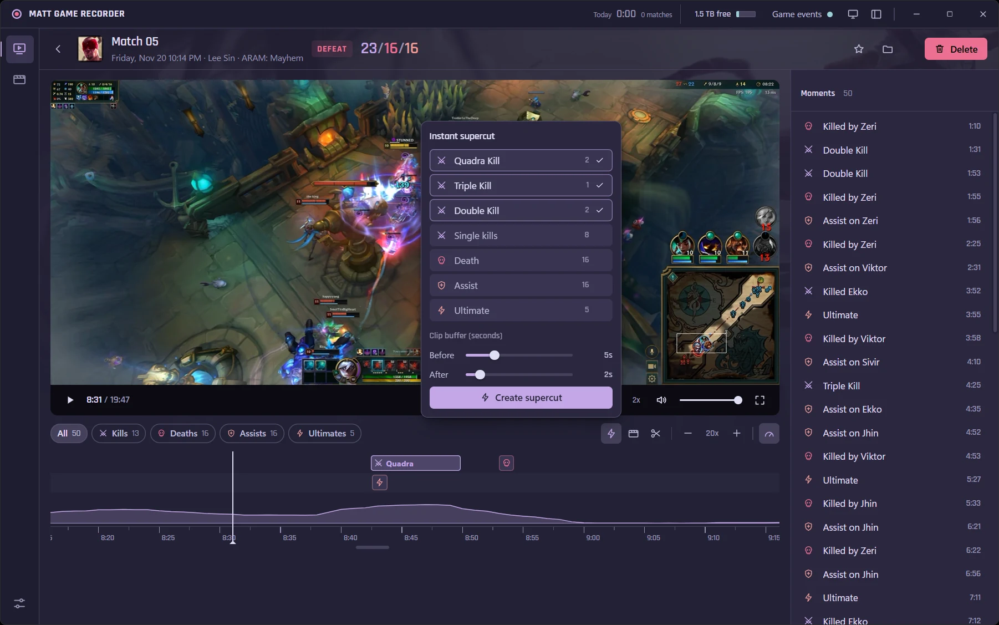
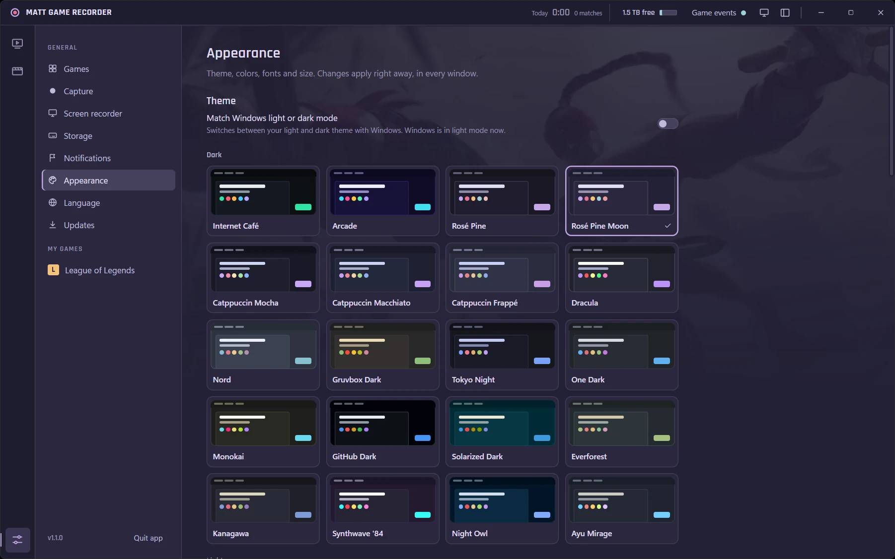
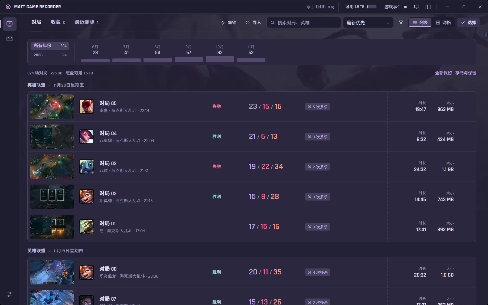

# Matt Game Recorder

**A local, ad-free League of Legends recorder for Windows and macOS.** It records every match on
its own, marks every kill, death and objective on the timeline, and gets you from "GG" to the
play you want to see in two clicks. No account, no cloud, no ads.

[**Download the latest release**](https://github.com/mattcui951/matt-game-recorder/releases/latest)

**Contents**

- [Features](#features)
  - [Every moment, already marked](#every-moment-already-marked)
  - [Your match history at a glance](#your-match-history-at-a-glance)
  - [A highlight reel in one click](#a-highlight-reel-in-one-click)
  - [Trim the play, share the clip](#trim-the-play-share-the-clip)
  - [Set it once, then forget it](#set-it-once-then-forget-it)
  - [Light on your PC](#light-on-your-pc)
  - [Make it yours](#make-it-yours)
- [Install](#install)
- [Updates](#updates)
- [Importing](#importing)
- [Contributing](#contributing)
- [Third-party software](#third-party-software)

## Features

### Every moment, already marked

Kills, deaths, assists, multikills, ultimates, dragons, barons, heralds, turrets, inhibitors and
the win itself land on the timeline while you play, read live from Riot's own game data. Click a
moment and the video jumps there. Filter to just your deaths for a quick review, or just your
kills for the fun part. The APM graph underneath shows where your hands were busiest.

### Your match history at a glance

Every game is a row with its champion, result, KDA, multikills, length and size, grouped by day,
with a month-by-month bar to jump through the year. Search by champion, filter by result or event,
keep favorites, and get back anything you deleted by mistake.

### A highlight reel in one click

Instant supercut picks the moments for you: tick quadra kills, triple kills, doubles, deaths or
ultimates, choose how many seconds to keep before and after each one, and it cuts them into one
video. Moments close together are joined, so nothing plays twice.

### Trim the play, share the clip

Quick trim zooms the timeline in on the moment, lets you drag the start and end, and saves it as a
new clip. For more, a small video editor combines clips from several games, slices and
reorders them, and exports in 16:9, 9:16 for phones, 1:1, 4:5 or 21:9.

### Set it once, then forget it

Pick how League is recorded: the full match, only the highlights around your events, the whole
session from client to close, or nothing until you press a hotkey. Choose which events get
bookmarked, and whether the app opens itself when the game ends.

### Light on your PC

- **Recording runs on the graphics card**, so it costs well under 1% CPU and your game keeps its
  frame rate.
- **Small files.** Efficient video compression, and a highlights mode that keeps only the seconds
  around your events.
- **Plain files on your disk.** Every recording is an ordinary MP4 video; copying the folder is a
  full backup.
- **Coming from Outplayed?** Import converts your old library, champion, KDA and timeline included.

### Make it yours

28 themes (dark, light and high contrast), each one tweakable, and eight languages: English,
简体中文, 繁體中文, Español, Français, 日本語, 한국어 and Русский.

<table>
  <tr>
    <td></td>
    <td></td>
  </tr>
</table>

## Install

**Windows:** download `Matt.Game.Recorder_*_x64-setup.exe` from the
[latest release](https://github.com/mattcui951/matt-game-recorder/releases/latest) and run it.
The installer is not code-signed, so Windows may say "Windows protected your PC": click
**More info**, then **Run anyway**. Recordings go to `Videos\Matt Game Recorder` until you pick
another folder in Settings > Storage.

**macOS (13 or later, Apple silicon or Intel):** download `Matt.Game.Recorder_*_universal.dmg`,
open it and drag the app to Applications. The app is signed and notarized by Apple. On first
start it asks for Screen & System Audio Recording (needed to record); APM and the ultimate mark
also need Input Monitoring, the microphone needs Microphone access. Settings > Capture shows
which permissions are missing and opens the right System Settings page. Recordings go to
`~/Movies/Matt Game Recorder`.

## Updates

The app checks for a new version shortly after it starts and every 6 hours (Settings > Updates
turns this off). A new version shows a banner; nothing installs until you click **Update now**,
and never while League is running or a match is being recorded or saved, because the installer
closes the app. Windows asks for permission (the app installs for all users), then the new
version starts by itself. Recordings, settings and an import in progress are kept; the import
resumes after the restart. Every update is signature-checked before it installs.

## Importing

Library > Import offers two imports. Both skip anything already imported, keep running in the
background, pause while a game is being recorded, and resume by themselves after a restart.

- **From Outplayed**: finds your Outplayed videos on its own, converts them to this app's format
  on the GPU (about 40% smaller) and keeps champion, KDA, result and timeline events.
  Outplayed's own files are never changed; its "Recently Deleted" folder is skipped.
  "Use the CPU as a second encoder" (asks first, off at every launch) converts a second video
  alongside the GPU to finish sooner; the app shows the speed-up measured on your PC.
- **From another Matt Game Recorder folder**: copies sessions and recordings (with their events)
  from another media folder or backup, without converting.

## Contributing

See [DEVELOPMENT.md](DEVELOPMENT.md) for how the app works and how to build, test and release it.

## Third-party software

The app includes FFmpeg, free software licensed under the GPL v3, and runs it as a separate
program. The Windows build is version n8.1.3-27-g8dca1586f4 by
[BtbN/FFmpeg-Builds](https://github.com/BtbN/FFmpeg-Builds) (2026-10-31); its source code is at
[git.ffmpeg.org](https://git.ffmpeg.org/ffmpeg.git) (commit `8dca1586f4`) and the build scripts
at BtbN/FFmpeg-Builds. The macOS build is FFmpeg 9.0.2, static builds by
[Martin Riedl](https://ffmpeg.martin-riedl.de) for arm64 and x86_64, joined into one universal
binary.
